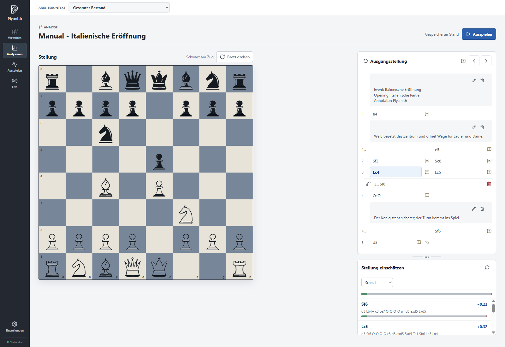
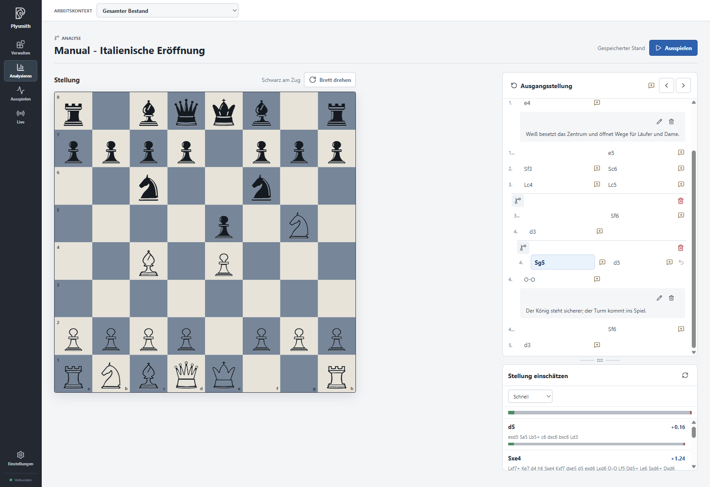
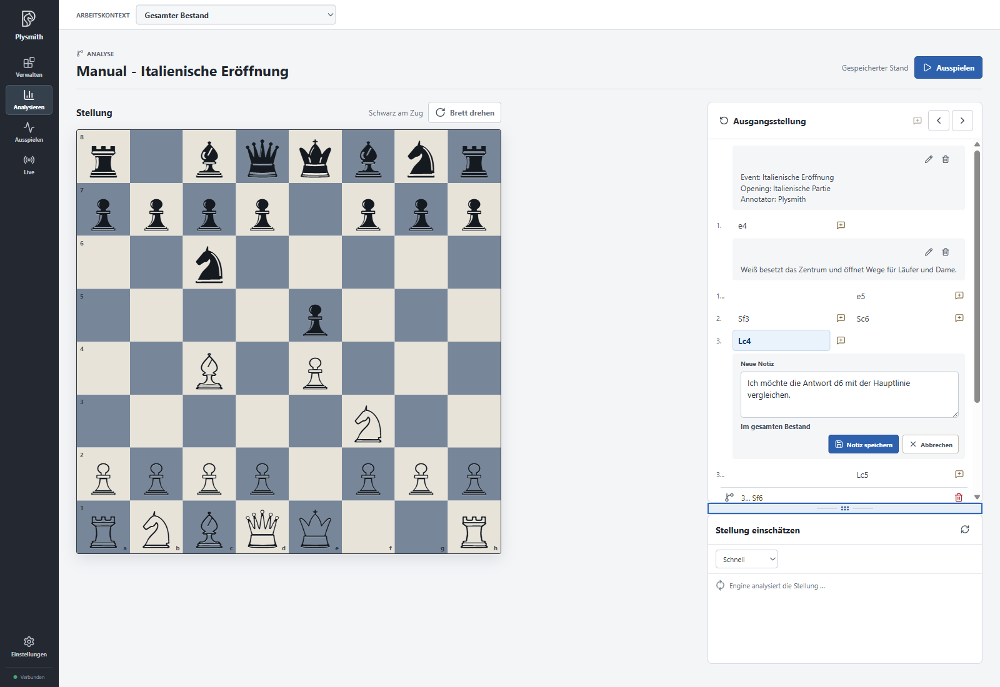
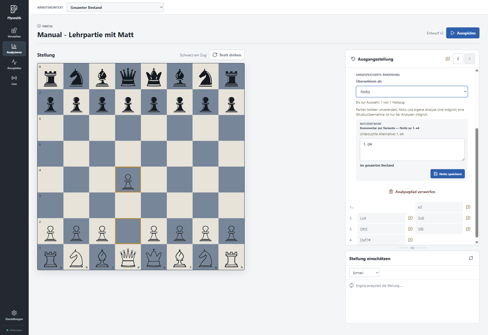
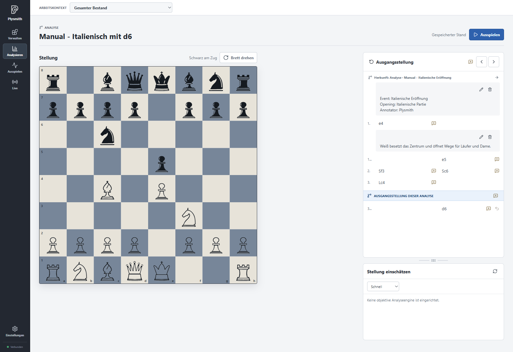
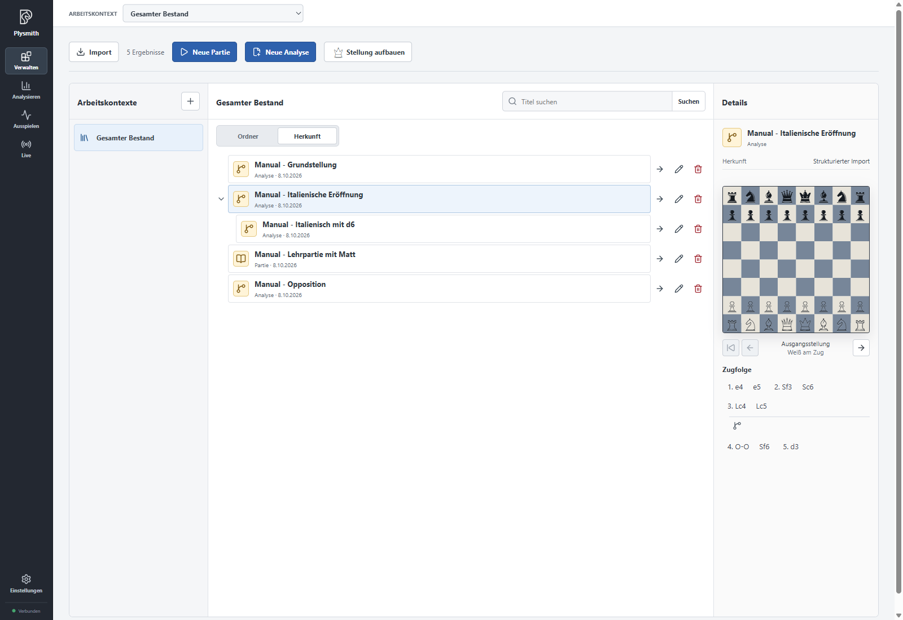
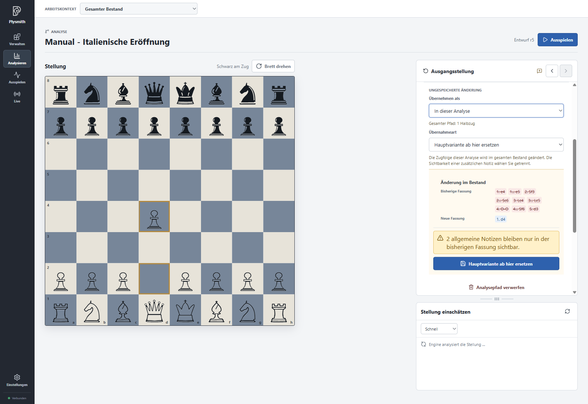
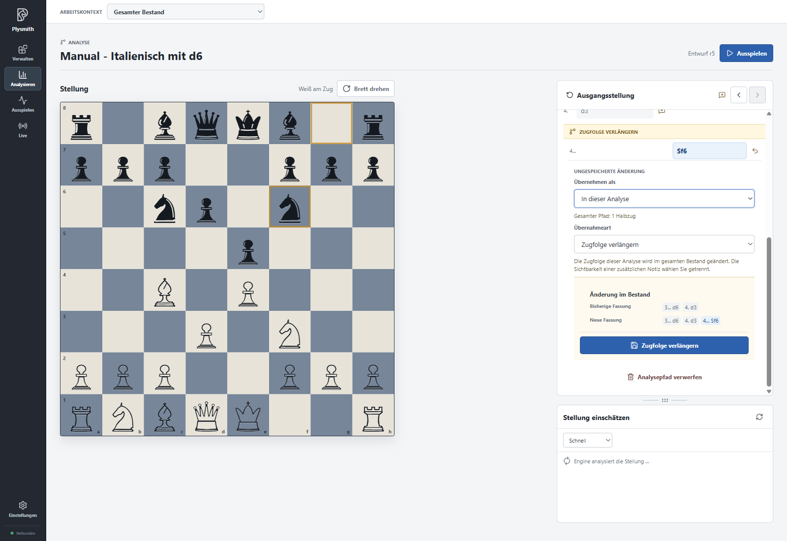
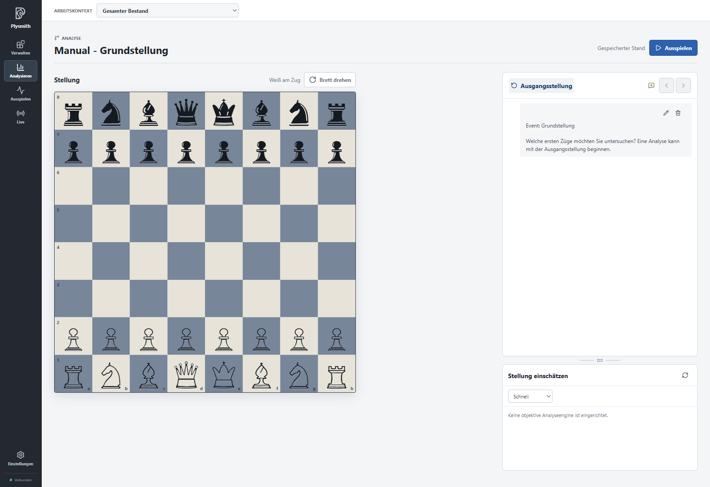
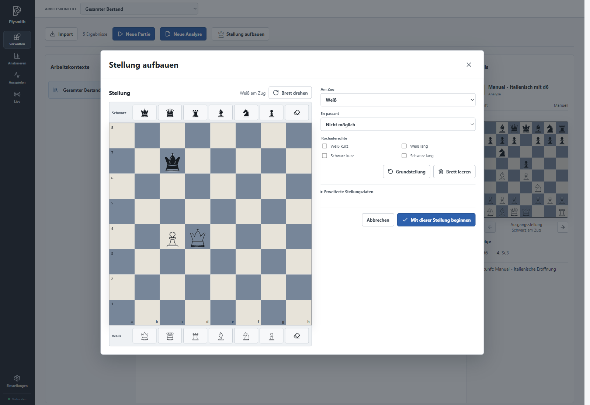

# Investigating positions and recording your thoughts

In **Manage**, open the analysis "Manual - Italienische Eröffnung" using the **Analyse** arrow. You do not need an engine yet: the following steps show how to investigate continuations yourself and keep your work.

> The screenshots use the real German UI and notation. Instructions use the English labels and notation: **3.Lc4** in a screenshot is **3.Bc4**, and **4.Sc3** is **4.Nc3**. The example titles remain unchanged. See the [language and notation note](README.en.md).

## Navigating moves and variations

The board is on the left and the move sequence on the right. Click **3.Bc4**. The board shows the position after this half-move. The **Previous move** and **Next move** arrows take you through the selected line. **Starting position** takes you to its beginning.

A collapsed variation shows its first half-move beside the branching icon. Expand the **3...Nf6** variation and select its first move. The preview disappears from the header, and the full continuation appears below it. You can now follow that continuation. Within it, **4.Ng5** is a further alternative to **4.d3**. Expand that branch too if you want to view it. Click **3...Bc5** in the main line to return to the main sequence.

The arrows follow the selected line; they do not simply move down through all visible variations. Previous and next navigation opens the required variations and highlights the current half-move in blue. Manually expanding and collapsing only changes the display. **Flip board** changes the viewing direction without changing the position or move sequence.

If engine evaluations appear below the move sequence, you can adjust the space between the two areas with the handle. The settings and engines chapter explains how to configure engines and read their results.

## Adding and editing notes

Select **1.e4** in the Italian opening. It already has an imported note about the centre. Use its **Edit note** pencil to add to the text. For example, add "Which reply by Black would I like to investigate more closely?" and choose **Save note**.

For a new thought, select **3.Bc4** and click the speech bubble with a plus at that half-move. In the simple interface, the note automatically applies throughout the inventory. Write something like "I want to compare the d6 reply with the main line" and save the note. It now belongs to this half-move.

The speech bubble beside **Starting position** lets you record a thought about the beginning. You can delete existing notes using their bin icon; the app asks for confirmation. Deleting a note does not change the saved moves.

## Trying a continuation on the board

Through **Manage**, switch to "Manual - Lehrpartie mit Matt" and open it in Analyse. Click **Starting position**. Click the white pawn on d2, then its destination square d4.

**Unsaved change** appears under **New analysis path**. You have begun your own continuation. The teaching game's saved sequence remains intact. **Accept as** is shown directly alongside the path. It always offers the same three destinations: **Note**, **In this analysis** and **Separate analysis**. Unavailable destinations are disabled with a short explanation; a game’s saved moves remain unchanged.

Plysmith remembers the provisional path even across a restart. Still, decide explicitly how to finish it. **Discard analysis path** ends the investigation without keeping it.

At the end of an analysis path, the curved **Take back last move** arrow lets you take back the most recent half-move. In a longer path, the preceding moves remain. If you also take back the last remaining half-move, the analysis path disappears and you return to its starting point. The saved move sequence remains unchanged. If you have entered text or a title in the save forms, Plysmith prevents taking back the last path move to preserve those entries. Save the path, clear the entries or explicitly choose **Discard analysis path**.

You can also take the move back directly on the board: click the piece that moved last, then its previous square. For **1.d4**, click the pawn on **d4**, then **d2**. This lets you try continuations and put pieces back as you would when analysing on a real chessboard. If you try the takeback, play **1.d4** again afterwards so you can turn this path into a note in the next step.

Notes and separate analyses use the continuation only through the selected half-move. The displayed scope makes this clear. To save a variation or change an existing move sequence, select the end of the path. At a line end, you can still choose between a variation and extending the line.

Switching destinations preserves your text, visibility and separate-analysis fields. If other destinations contain drafted text, you must explicitly acknowledge discarding it before the final save. These form fields are retained for the current app session; the path’s restart persistence is separate.

### Turning the path into a note

For the move **1.d4** you just tried, choose **Accept as → Note**. The move sequence now appears in the note draft. In the simple interface, this note also applies throughout the inventory. Add "Alternative to the start of the teaching game" and click **Save note**.

The continuation is now recorded as an editable note on **1.e4**, the saved half-move being replaced by the explored **1.d4** alternative. At a branch point, the note belongs to the replaced following half-move; at the end of a saved line it belongs to the last half-move. If the analysis has no moves yet, it belongs to the starting position. It creates neither a new game nor a variation in the played sequence. Open the note again later to change its text.

### Saving as a separate analysis

Open "Manual - Italienische Eröffnung" again and select **3.Bc4**. Play **3...d6** on the board by clicking the black pawn on d7, then d6. Choose **Accept as → Separate analysis** for the new path.

Enter `Manual - Italienisch mit d6` as the **Title**. Under **Location**, choose the **Manual** folder or **Origin folder**. Confirm with **Save analysis**. This separate analysis will serve as the working analysis for the rest of the exercises.

The new analysis begins after **3.Bc4**. The blue boundary **Starting position of this analysis** separates the displayed source move sequence from its own moves. **3...d6** is initially its only move. The preceding moves explain its origin; you have not copied them as its own main line.

Click **Starting position of this analysis** to go to its own beginning. **Starting position** above the move sequence instead shows the beginning of the source sequence. You can view that source position, but cannot start your own continuation on the board there.

You will now find an additional entry in **Manage**. In **Origins**, it belongs to the Italian opening's family. The source remains an independent entry with its main line unchanged. Later changes to either analysis are not automatically applied to the other.

### Saving a variation in the same analysis

Try a variation in the new working analysis. This preserves the imported example's saved move structure for later chapters.

Open "Manual - Italienisch mit d6", select **3...d6** and play **4.d3**. Choose **Accept as → In this analysis**, then **Extend line** under **How to accept**. Check the preview and confirm with **Extend line**. Its own main line now consists of **3...d6 4.d3**.

Select **3...d6** again and try **4.Nc3** instead. This time, choose **Accept as → In this analysis**, then **Save as variation** under **How to accept**. Check the displayed continuation and confirm with **Save as variation**. **4.d3** remains the main continuation; **4.Nc3** appears alongside it as an expandable alternative. No further inventory entry is created.

When saving, you can also select **Also save move sequence as a comment** and edit that comment. Leave this option off for the exercise: the new variation itself already contains the continuation.

The screenshot shows the same options in the imported Italian analysis, with a path from the initial position. In your working analysis, choose **Save as variation** accordingly. The **In this analysis** destination is disabled for a **Game**, because its saved moves record what was played.

## Editing the main line deliberately

Stay in **Manual - Italienisch mit d6** for all the following changes. Each step ends with saving; the next step builds on the resulting state.

### Extending

Select **4.d3** in the main line and play **4...Nf6**. Choose **Accept as → In this analysis**, then **Extend line** under **How to accept**. The preview shows the previous and new versions. Check that only **4...Nf6** is added, then choose **Extend line**.

### Shortening

Select the last main line move, **4...Nf6**, and click **Take back last move**, the curved arrow at that move. Plysmith prepares **Shorten line**. Check in the preview that **4...Nf6** is removed and **4.d3** remains the last main line move. Confirm with **Save**.

This differs from the left navigation arrow, which only shows an earlier position. In a saved analysis, **Take back last move** prepares a change to the move sequence.

### Removing a variation

Expand the **4.Nc3** variation. At its branch header, choose the **Delete variation** bin icon. Check the continuation being removed and confirm the change with **Save**. The main line **3...d6 4.d3** remains.

For a longer variation, its subsequent moves and any branches within it are also removed. Affected notes are listed in the preview. Simply collapsing it with the branching icon removes nothing.

### Replacing a continuation

Select **3...d6** again and play **4.Nc3**. Choose **Accept as → In this analysis**, then **Replace main line from here** under **How to accept**. Check that the new version contains **4.Nc3** in place of **4.d3**, then confirm with **Replace main line from here**.

Your working analysis now has its own main line **3...d6 4.Nc3**. None of these steps changed the original Italian opening.

Before changes, Plysmith also checks whether notes or other work in progress are affected. A message about a note in the previous version means its reference does not fit unchanged into the new version. Read the specific consequences. The loss dialog remains available in the simple interface and lists affected content in existing working contexts, even while their controls are hidden. The destination selector lets you switch to **Note** or **Separate analysis** and continue investigating on the board. Saving requires a separate confirmation. When shortening or deleting, **Continue editing** returns you to preparation. Effects on working contexts are covered in the final chapter on contexts.

## Starting a new analysis without a source

You can also begin independently of an existing entry. In **Manage**, choose **New analysis** to work from the initial position. You can already keep the starting position without a single move using **Accept as → Separate analysis**. Give it a new, unique title.

The screenshot shows "Manual - Grundstellung", which was already created by the import. You do not need another entry for the exercises. Starting without moves will be useful again when building an opening library later.

For a different starting position, choose **Set up a position**. Use **Clear board** to begin placing pieces from the selection onto the desired squares. Set **Side to move**, the appropriate **Castling rights** and, if applicable, the en passant option. **Advanced position data** contains the half-move clock and move number. You can also enter an existing position string there and load it with **Apply FEN**.

As a short exercise, you can set up our "Opposition" position: white king on d4, white pawn on c4, black king on c7, White to move, no castling rights. **Begin with this position** checks the position and opens the analysis board. Missing kings or other invalid details must be corrected first.

If you do this additional exercise, finish it with **Discard analysis path**. The imported "Manual - Opposition" remains your example for playing out a position later. Even if you saved the position you set up yourself, it would have no origin connection to that entry: an identical position alone does not create a derivation.

If an investigation is still open when you open another entry, Plysmith offers to continue or discard it. Apply or save an investigation first if you want to keep it. This keeps the distinction clear between content already in the inventory and work still in progress.

[Back to overview](README.en.md). Next: [Settings and engines](04-settings.en.md).
